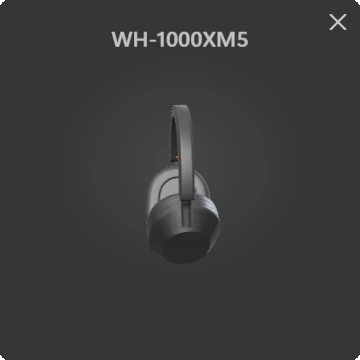

# Open Headphones Connect

An unofficial, open-source companion for Sony headphones on Windows 11. Not made by or
affiliated with Sony.

  
  &nbsp;&nbsp;
  

## Download

Get the installer from the [latest release](https://github.com/yaay/open-headphones-connect/releases/latest).
Windows 11, 64-bit; no administrator rights needed.

The installer is not code-signed, so Windows shows "Windows protected your PC" the first time:
choose *More info*, then *Run anyway*. Pair the headphones in Windows first. The app then lives
in the notification area: left-click its icon for the panel, right-click to quit.

## What it does

- **Connect card** with a 3D model of your headphones, battery level and noise mode whenever
  they connect
- **Battery** in the tray icon, with a notification when it runs low
- **Noise control**: noise cancelling, wind noise reduction, ambient sound
- **Playback**: volume, play / pause, skip
- **Equalizer** and the headphones' own settings: DSEE, Speak-to-Chat, touch panel, connecting
  to two devices, voice guidance, automatic power-off
- **One-click connect / disconnect**, and start with Windows

## Supported headphones

| Headphones | Status | Notes |
| --- | --- | --- |
| **WH-1000XM6** | ✅ Works | |
| **WH-1000XM4** | ✅ Works | |
| **WH-1000XM3** | ✅ Works | |
| **ULT WEAR** | ⚠️ Mostly works | The equalizer and the touch panel switch are fixed in 0.2.1, not yet confirmed ([a user's report](https://github.com/yaay/open-headphones-connect/issues/1)) |
| WH-1000XM5 | ❔ Untested | |
| WH-1000XM2 | ❔ Untested | |
| WF-1000XM5, WF-1000XM4, WF-1000XM3 | ❔ Untested | |
| LinkBuds, LinkBuds S, Fit, Open, Clip | ❔ Untested | |
| WH-CH720N, WH-XB900N | ❔ Untested | |
| Headphones from other brands | ❌ Not supported | Sony headphones only |

"Works" means everything in the list above: the connect card, battery, noise control, playback,
the equalizer and the headphones' settings.

Is yours untested? Try it anyway, then [tell us how it went](https://github.com/yaay/open-headphones-connect/issues/new?template=headphones-report.yml).
That is how headphones move up this table.

## More

- [Supported headphones and reporting](docs/headphones.md)
- [Your own 3D model on the connect card](docs/custom-model.md)
- [Building and how it works](docs/development.md)
- [Changelog](CHANGELOG.md)

## Credits

Built on the protocol work of [SonyHeadphonesClient](https://github.com/Plutoberth/SonyHeadphonesClient)
by Plutoberth, [Sony Tray](https://github.com/abhiinhii/sony-tray) by abhiinhii, and
[SonyHeadphonesClient](https://github.com/mos9527/SonyHeadphonesClient) by mos9527, Amr Satrio
and contributors. The WH-1000XM5 on the connect card is the 3D model
[Sony Wh-1000xm5](https://sketchfab.com/3d-models/sony-wh-1000xm5-5d8aea0a780b49fa89c9c205912414e3) by Zalaneke, used under
[CC BY 4.0](https://creativecommons.org/licenses/by/4.0/).

MIT licensed, apart from that model; see [LICENSE](LICENSE). Sony and its product names are trademarks of Sony Group
Corporation, used here only to say what this software works with.
