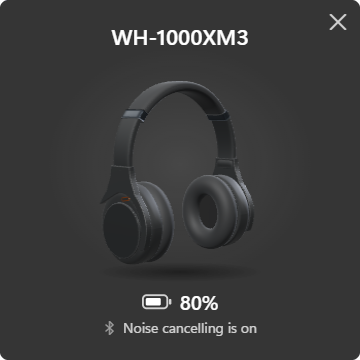
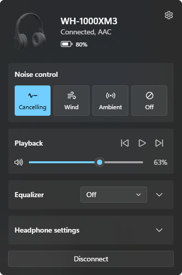

# Open Headphones Connect

An unofficial, open-source companion for Sony headphones on Windows 11: a connect card, the
battery in your tray, noise control, the equalizer and the headphones' own settings.

> **Not a Sony product.** This project is not made by, affiliated with, endorsed by or
> sponsored by Sony. Sony's own app is "Sony | Sound Connect" (formerly "Headphones Connect")
> for Android and iOS; there is no official Windows version, which is why this exists.

[](https://github.com/yaay/open-headphones-connect/actions/workflows/ci.yml)
[](https://github.com/yaay/open-headphones-connect/releases/latest)
[](LICENSE)

<p align="center">
  
  &nbsp;&nbsp;
  
</p>

When the headphones connect, a card slides up from the corner of the screen: a 3D model spins
into view and settles, then the battery level and noise mode appear. A tray icon shows the
battery percentage, and clicking it opens a panel with everything else.

## Download

Get the installer from the [latest release](https://github.com/yaay/open-headphones-connect/releases/latest)
and run it. It installs for your user only and needs no administrator rights.

- **Windows 11, 64-bit.** Windows 10 may work but has not been tried.
- **Windows will warn you the first time.** The installer is not code-signed (certificates cost
  money this project does not have), so SmartScreen shows "Windows protected your PC". Choose
  *More info*, then *Run anyway*. Each release lists the installer's SHA-256 so you can check the
  file you downloaded is the one published here.
- **Pair the headphones in Windows first** (Settings, Bluetooth & devices). After that the app
  finds them by itself. Left-click the tray icon for the panel, right-click to quit.

Only one program can hold the headphones' control connection at a time. If the panel says the
headphones aren't answering, close Sony's app on your phone.

## What it does

- **Connect card** with a 3D model, battery level and the active noise mode
- **Battery in the tray icon**, with a notification at 20%
- **Noise control**: noise cancelling, wind noise reduction, ambient sound (level and focus on voice), off
- **Playback**: volume, play / pause and skipping tracks, relayed through the headphones
- **Equalizer**: the presets, bands and range the headphones themselves describe
- **Headphone settings**: DSEE upscaling, Speak-to-Chat, pause when taken off, touch panel,
  connecting to two devices, voice guidance and automatic power-off
- **One-click connect / disconnect** of the headphones' audio, without opening Bluetooth settings
- **Power off** the headphones from the PC, on models that allow it (the WH-1000XM3 does not)
- **Start with Windows**, running quietly in the notification area

Each headset is asked what it has when it connects, and the panel shows only that: earbuds get
left, right and case batteries, and open earbuds without noise control get no noise section.

## Supported headphones

| Headphones | Protocol | Status |
| --- | --- | --- |
| WH-1000XM3 | first generation | Tested on real hardware (firmware 4.5.2) |
| WH-1000XM2, WH-1000XM4, WF-1000XM3, WH-H900N, WH-XB900N | first generation | Same command table, untested |
| WF-1000XM5, LinkBuds Clip | second generation | Reading checked against recordings of real units; never connected here |
| WH-1000XM5 / XM6, WF-1000XM4, other LinkBuds, ULT Wear, WH-CH720N | second generation | Same command tables, untested |

**Only the WH-1000XM3 has been connected to this app.** On it the following has been confirmed
against the headset itself: opening the control link, reading battery, noise mode, equalizer,
firmware and codec, the connect card on every reconnect, the playback controls and the headphone
settings. Not yet exercised on hardware: switching between noise modes, changing the equalizer,
and the audio connect / disconnect button (Windows does list the headset's two audio devices
that the button acts on).

For second-generation headsets, what the app reads is tested by replaying sessions recorded from
real WF-1000XM5 and LinkBuds Clip earbuds (`src-tauri/src/protocol/fixtures/`). What it writes
follows Sony's message tables as published in libmdr, and has not been sent to a real headset
from this app. Of the twelve noise-control layouts Sony defines, libmdr drives three (the XM5
kind, the adaptive kind and ambient-only); the other nine are implemented from the tables alone.
The same goes for first-generation models with only noise cancelling or only ambient sound, and
for Speak-to-Chat and pause when taken off on the WH-1000XM4.

Switching "connect to two devices" makes the headphones drop and re-establish their Bluetooth
connection; the app answers the headset's "go ahead?" for you when you flip that switch.

### Tell us how yours behaves

If you own anything other than a WH-1000XM3, a report is the most useful contribution there is,
whether it works or not. [Open a headphones report](https://github.com/yaay/open-headphones-connect/issues/new?template=headphones-report.yml)
and attach a trace:

1. Quit the app (right-click the tray icon).
2. Start it from PowerShell with tracing on:

   ```powershell
   $env:OHC_TRACE = "1"; & "$env:LOCALAPPDATA\Open Headphones Connect\open-headphones-connect.exe"
   ```

3. Connect the headphones, try the controls that misbehave, then attach
   `%LocalAppData%\dev.openheadphonesconnect.desktop\logs\app.log`.

The trace holds every message exchanged with the headphones: the model name, firmware version
and settings, and nothing about you or your PC. Messages the app does not understand are
written to the same log even without tracing.

## Using your own 3D model

The connect card shows a built-in 3D model, generated in code and deliberately plain. You can
replace it with any model of your own by placing two files in
`%AppData%\dev.openheadphonesconnect.desktop\`:

- `model.glb`: the model, as binary glTF (Meshopt compression and WebP textures are supported).
- `model.json` (optional): how to place it.

```json
{
  "rotation": [0, -46.3, 0],
  "scale": 1,
  "roughness": 0.62,
  "brightness": 1.3,
  "tint": [0.88, 0.94, 1.0],
  "cutout": ["lambert6"]
}
```

`rotation` (degrees about X, Y, Z) turns the model so it stands upright facing the viewer.
The model is framed automatically; `scale` makes it larger or smaller from there, and
`brightness` adjusts the lighting. `tint` multiplies every colour, and `cutout` names materials
whose texture is transparent apart from printed labels. Restart the app after changing either
file. The same model is used for the small picture in the panel header. The colour option in
settings applies to the built-in model only.

A large model is worth slimming first, which also makes the card appear sooner:

```powershell
npx @gltf-transform/cli optimize in.gltf model.glb --compress meshopt --simplify-ratio 0.2 --simplify-error 0.0004 --texture-compress webp --texture-size 1024 --palette false
```

The model is read from your settings folder at run time. It is never copied into the app or
this repository, so what you use there is between you and the model's author: check its licence
before sharing a build that depends on it. While developing, the same two files in `local/`
(git-ignored) are picked up by `npm run dev` and `npm run app:dev`.

## Building

Needs Node 20+, Rust (the pinned toolchain installs itself through rustup) and the Visual Studio
C++ build tools with a Windows SDK.

```powershell
npm install
npm run app:dev          # run with live reload
npm run app:build        # release build and installer
```

`npm run dev` on its own opens the UI in a browser with simulated headphones (an XM3, earbuds,
and open earbuds without noise control), which is the quick way to work on the design.

```powershell
cd src-tauri; cargo test --lib     # protocol, session, tray icon and settings tests
```

If your system drive is short of space, or the machine's Windows SDK is incomplete, dot-source
`scripts\env.ps1` first; the comments at its top explain what it can do.

To see what a headset reports without the app's own logic in the way, a debug build has a probe:

```powershell
cd src-tauri
cargo run -- --probe          # read-only: paired devices, services, every query and its reply
cargo run -- --probe-write    # the same, then re-sends the noise mode the headset is already in
```

## How it is put together

Built with Tauri 2: a Rust core that speaks Sony's Bluetooth control protocol, and a small React
UI styled after Windows 11 flyouts.

```
src/                    React UI
  Card.tsx              the connect card
  Headphones3D.tsx      3D renderer and the spin-in animation
  headphoneModel.ts     the built-in model, generated from code, and the loader for your own
  Panel.tsx             tray panel: noise control, playback, equalizer, settings
  Headphones.tsx        flat drawing, used only where 3D is not available
  backend.ts            bridge to Rust, plus the browser simulator
src-tauri/src/
  protocol/framing.rs   packet framing, escaping, checksum
  protocol/v1.rs        commands for the WH-1000XM3 generation
  protocol/v2.rs        commands for the XM5 generation
  protocol/fixtures/    recorded sessions of real headsets, replayed by the tests
  bluetooth/mod.rs      finding the paired headset
  bluetooth/link.rs     the RFCOMM control socket
  bluetooth/probe.rs    the --probe diagnostic
  bluetooth/audio.rs    connect / disconnect audio
  session.rs            connection state machine
  flyout.rs             window placement and slide-in
  tray.rs               tray icon drawing
  lib.rs                app wiring and commands
```

Two things about these headphones that cost time to find out, in case you work on this:

- The XM3 keeps its control service out of the public Bluetooth service list, so the WinRT
  RFCOMM API cannot find it. The app connects with a plain Bluetooth socket instead, which asks
  the headset for that service by id.
- Asked a second question before it has answered the first, the XM3 drops the first answer
  without a word. The app therefore waits for each answer before asking the next question.

## Contributing

Reports from other headphone models come first (see above). For code, open an issue before a
large change so the direction can be agreed; small fixes can go straight to a pull request.
`cargo test --lib` and `npx tsc --noEmit` should pass, and the GitHub build runs both.

## Credits

- [SonyHeadphonesClient](https://github.com/Plutoberth/SonyHeadphonesClient) by Plutoberth (MIT):
  the original reverse engineering of the protocol and the WH-1000XM3 noise-control command.
- [Sony Tray](https://github.com/abhiinhii/sony-tray) by abhiinhii (MIT): the first version of
  the second-generation commands, and the session design.
- [SonyHeadphonesClient](https://github.com/mos9527/SonyHeadphonesClient) by mos9527, Amr Satrio
  and contributors (MIT): the message tables of both generations for capabilities, noise-control
  layouts, playback, the equalizer, DSEE, general settings, Speak-to-Chat, automatic power-off and
  voice guidance, and the recorded WH-1000XM3, WF-1000XM5 and LinkBuds Clip sessions that the
  tests replay (`src-tauri/src/protocol/fixtures/`).
- [AirPodsDesktop](https://github.com/SpriteOvO/AirPodsDesktop) by SpriteOvO: the idea of a
  connect popup on Windows. No code or artwork from it is used.

## Legal

MIT licensed; see [LICENSE](LICENSE), which also carries the notices of the projects above.

Sony, WH-1000XM3, LinkBuds, Sound Connect and Headphones Connect are trademarks of Sony Group
Corporation or its affiliates. They are used here only to say which products this software works
with. The headphones on the connect card are a 3D model generated in code
(`src/headphoneModel.ts`), proportioned against photos of the WH-1000XM3; no product images and
no logos are bundled.
